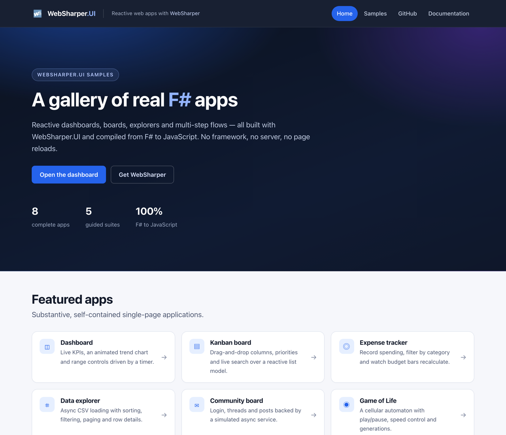

# WebSharper.UI samples

A gallery of **eight complete apps** and **five guided suites** built with
[WebSharper.UI](https://docs.websharper.com/ui/reactive) — the reactive, composable
user-interface library for F#. Everything is compiled from F# to JavaScript and
runs entirely in the browser; the gallery itself is a WebSharper.UI SPA.

[](https://websharper-samples.github.io/ui/)

**[Try it live](https://websharper-samples.github.io/ui/)** ·
[WebSharper](https://websharper.com) ·
[Library source](https://github.com/dotnet-websharper/ui)

## Apps

Substantive, self-contained applications that combine variables, views,
collections, forms, async loading and SVG charts.

| App | What it demonstrates |
|---|---|
| [Dashboard](https://websharper-samples.github.io/ui/#/samples/Dashboard) | Live KPIs, range controls and an animated trend chart fed by a timer |
| [Kanban board](https://websharper-samples.github.io/ui/#/samples/KanbanBoard) | Drag-and-drop columns, priorities and search over a `ListModel` |
| [Expense tracker](https://websharper-samples.github.io/ui/#/samples/ExpenseTracker) | Forms, typed categories, a budget bar and a live breakdown |
| [Data explorer](https://websharper-samples.github.io/ui/#/samples/DataExplorer) | Async CSV loading, search, sorting, paging and row details |
| [Todos](https://websharper-samples.github.io/ui/#/samples/TodoApp) | Priorities, filters, progress and bulk actions |
| [Community board](https://websharper-samples.github.io/ui/#/samples/CommunityBoard) | Sign-in, threads, replies and search over a simulated async service |
| [Game of Life](https://websharper-samples.github.io/ui/#/samples/GameOfLife) | A cellular automaton with timers, speed control and a reactive grid |
| [Onboarding flow](https://websharper-samples.github.io/ui/#/samples/OnboardingFlow) | A validated, animated multi-step `Flow` with review and restart |

## Suites

Focused tours of one part of the library, with several demos per page.

| Suite | Contents |
|---|---|
| [Reactive basics](https://websharper-samples.github.io/ui/#/samples/VarPlayground) | Vars, derived views, HTML templates and a small calculator |
| [Collections & selection](https://websharper-samples.github.io/ui/#/samples/CollectionsSuite) | Filterable lists, editable records, check boxes and radios |
| [Pointer & keyboard](https://websharper-samples.github.io/ui/#/samples/InputInspector) | Live mouse/keyboard views, a click pad and a virtual keyboard |
| [Chart lab](https://websharper-samples.github.io/ui/#/samples/ChartLab) | Animated CSV-driven bar charts and sortable SVG charts |
| [Mini-site](https://websharper-samples.github.io/ui/#/samples/MiniSite) | A routed, animated multi-page site nested in the gallery router |

## How it works

- `src/wwwroot/index.html` is the **whole-page HTML template**. Its two typed
  holes — `ws-hole="Nav"` and `ws-hole="Main"` — are filled by the site shell:

  ```fsharp
  ShellTemplate()
      .Nav(NavBar var)
      .Main(main)
      .Bind()
  ```

- `src/Samples.fs` defines the sample catalogue, the app/suite grouping and the
  route type. Routing is hash-based (`#/samples/Dashboard`), so the static build
  works on GitHub Pages without server rewrites.
- Each app and suite lives in its own F# file and registers itself with
  `Samples.Build(...)`. There are no external UI or chart dependencies:
  the charts in `src/Charts.fs` are small SVG helpers, and the design system in
  `src/wwwroot/style.css` is self-contained.

## Project structure

```
ui/
  src/
    Utilities.fs            # shared UI helpers
    Charts.fs               # dependency-free SVG chart components
    Samples.fs              # catalogue, sidebar, sample framework
    Site.fs                 # shell, home page, navigation, routing
    Client.fs               # [<SPAEntryPoint>]
    Dashboard.fs            # \
    KanbanBoard.fs          #  |
    ExpenseTracker.fs       #  |  apps
    DataExplorer.fs         #  |
    TodoApp.fs              #  |
    CommunityBoard.fs       #  |
    GameOfLife.fs           #  |
    OnboardingFlow.fs       # /
    VarPlayground.fs        # \
    CollectionsSuite.fs     #  |
    InputInspector.fs       #  |  suites
    ChartLab.fs             #  |
    MiniSite.fs             # /
    InputTransformTemplate.html
    wwwroot/
      index.html            # whole-page gallery template
      style.css             # self-contained design system
      DataExplorer.csv      # dataset for the data explorer
      ObjectConstancy.csv   # dataset for the chart lab
      AlphaFrequency.csv    # dataset for the chart lab
      files/                # logo
    wsconfig.json           # WebSharper SPA settings
    package.json            # esbuild
    esbuild.config.mjs      # bundles Release output into dist/
  docs/screenshot.png
  .github/workflows/deploy.yml
  README.md
```

## Running locally

The site is fully static: build it in Release, then serve `dist/`.

```bash
dotnet build src/WebSharper.UI.Samples.fsproj -c Release
python3 -m http.server 5290 --bind 127.0.0.1 --directory dist
```

Open <http://127.0.0.1:5290/>. (`npm run serve` does the same from `src/`.)

## Building

```bash
dotnet build src/WebSharper.UI.Samples.fsproj -c Release
```

WebSharper compiles the F# sources to `src/build/`, and
[esbuild](https://esbuild.github.io/) bundles the entry point to
`dist/Scripts/WebSharper.UI.Samples.min.js` while copying the static assets to
`dist/`.

## Deployment

Every push to `main` triggers
[`.github/workflows/deploy.yml`](.github/workflows/deploy.yml), which builds in
Release and publishes `dist/` to the `gh-pages` branch with GitHub Pages.

---

Built with [WebSharper](https://websharper.com). WebSharper is open source;
see the [library repository](https://github.com/dotnet-websharper/ui).